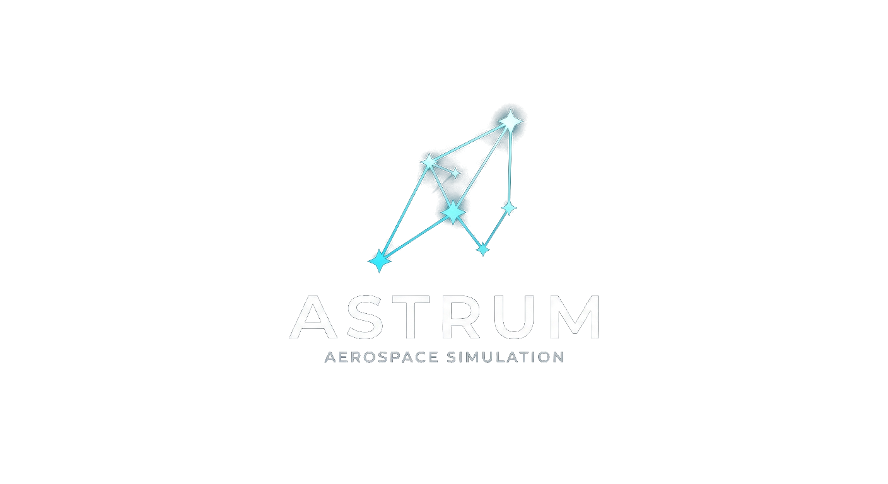
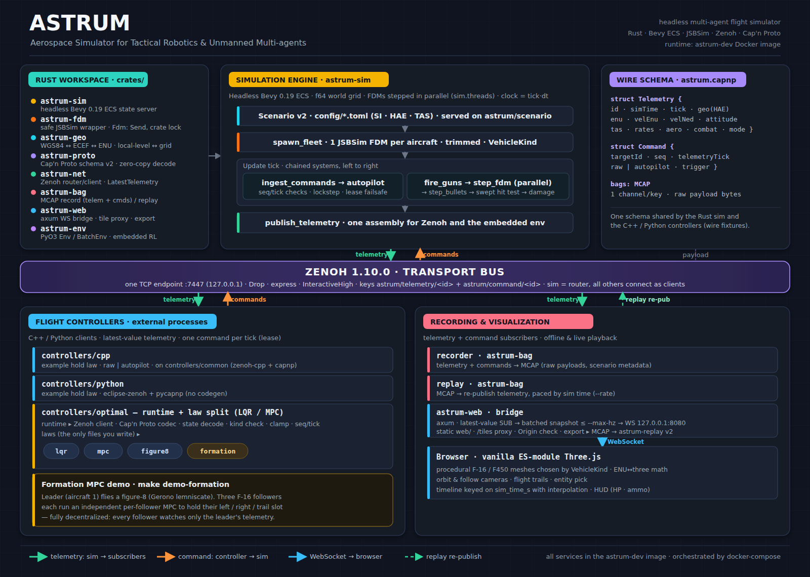

<p align="center"></p>

# ASTRUM

A simulation environment for **multi-agent flight** — dozens to hundreds of independent
fixed-wing aircraft and sUAS quadrotors, each with its own high-fidelity flight dynamics.

- **Bevy + Rust** ECS as the authoritative ("know-it-all") state server (headless — no renderer).
- **JSBSim** 6-DOF flight dynamics embedded via Rust FFI; **each entity owns its own FDM instance**,
  stepped in parallel on a configurable thread pool.
- Two **vehicle classes** — fixed-wing and multirotor (quadrotor) — share one wire protocol; the
  sim applies the right control law per aircraft (chosen by `VehicleKind`).
- **Geodetic ↔ Cartesian (ENU)** coordinate mapping so global lat/lon/height state lives on a local grid.
- **Zenoh** messaging backbone: the sim broadcasts telemetry and ingests flight-control commands.
- Flight controllers live **outside** the sim (C++ and Python) and talk only over Zenoh.
- **Cap'n Proto** wire format (schema v2), shared across Rust / C++ / Python and pinned by
  cross-language wire fixtures.
- An **embedded multi-agent RL environment** (`astrum_env`, Python) that steps the same sim
  in-process with no network.

Telemetry and commands can be recorded to an **MCAP** bag and the telemetry replayed to any
subscriber with the recorded payload bytes, and a browser-based **3-D replay renderer**
(Three.js, procedural meshes) visualises the fleet live or from an exported bag — `make replay`,
then open http://localhost:8080.

## Status

Everything below is built and tested; here's what lives where:

| Component | Responsibility |
|---|---|
| `astrum-fdm` | safe JSBSim 6-DOF wrapper (C shim catches every C++ exception; crate-owned lock makes `Fdm: Send`) |
| `astrum-geo` | WGS84 geodetic ↔ ECEF ↔ ENU mapping, local-level ↔ grid rotations |
| `astrum-sim` | headless Bevy ECS state server — one JSBSim FDM per entity, combat, lease/failsafe, lockstep |
| `astrum-proto` + `astrum-net` | Cap'n Proto schema v2 + Zenoh transport (telemetry, commands, scenario, controller presence, run control) + `astrum-ctl` |
| `astrum-bag` | record telemetry + commands to MCAP; replay telemetry paced by sim time |
| `astrum-env` | Python bindings (`Env`, `BatchEnv`) + the Gymnasium-style dogfight adapter |
| `astrum-web` + `web/` | axum telemetry bridge + tile proxy, offline exporter, browser 3-D renderer |
| `controllers/common` | shared C++ wire codec + Zenoh client (and the wire-fixture tool) |
| `controllers/cpp`, `controllers/python` | out-of-sim example flight controllers |
| `controllers/optimal` | C++/Python runtime + law split: LQR, MPC, figure-eight, formation |
| `docs/` | architecture diagram, dogfight environment design + onboarding |

`make demo` brings up the sim and a C++ controller that flies an aircraft to a commanded
heading/altitude over Zenoh (`make demo-python` runs the equivalent Python controller).
`make demo-quad` flies ASTRUM's second vehicle class — an **F450 quadrotor** that climbs and yaws
under the built-in multirotor hover-hold autopilot. `make demo-formation` flies a figure-eight
leader with three decentralized MPC followers. `make smoke` runs all four and fails on the first
failure. `make replay` starts the fleet alongside the 3-D renderer.

## Architecture & data flow



`astrum-sim` is the authoritative state server: a headless Bevy ECS where **each aircraft entity
owns its own JSBSim instance**. Controllers, recorders and the web bridge are separate processes
that only ever touch it through Zenoh + Cap'n Proto — never shared memory. Telemetry, commands,
controller presence and the scenario, control and status queries are key expressions multiplexed
over **one** Zenoh session (a single TCP endpoint), not separate ports.

Each `Update` tick runs one chained schedule:

```
serve_control      apply pause / resume / step / speed requests (paused: hold here, re-sending telemetry)
track_controllers  a controller's token went away → lockstep run fails / aircraft → failsafe hold
                   — the rest runs only while not paused —
ingest_commands    decode astrum/command/<id>; refuse stale/future/duplicate/forged; (lockstep: wait)
expire_leases      a raw command older than command_lease_s → failsafe hold
autopilot_step     autopilot / failsafe targets → fcs/*-cmd-norm (per VehicleKind)
fire_guns          rounds leave the muzzle at t_k
step_fdm           every FDM steps once; with sim.threads > 1 each on its fixed worker
freeze_dead → advance_clock → step_bullets → resolve_hits → apply_damage → end_on_elimination
publish_telemetry  one Telemetry per aircraft → put astrum/telemetry/<id> (at its control_rate_hz);
                   with --record every tick of every aircraft goes to the MCAP bag
report_progress / stop_at_max_time, then pace (sim.speed > 0)
publish_status     refresh what get astrum/status answers (every 100 ms and on any control change)
```

Controllers write **control inputs** (`fcs/*-cmd-norm`), never state; JSBSim computes all motion
and the ECS world-grid state (f64, no Bevy `Transform`) is a downstream mirror of its output,
never fed back into the physics. The sim clock is `tick · dt`, independent of any aircraft. Every
startup failure (bad scenario, model load, trim, network) exits non-zero with a message.

### Coordinate conventions

Aircraft state is authored and integrated in **geodetic** WGS84 (JSBSim uses *geodetic* latitude).
Heights are **above the WGS84 ellipsoid (HAE)** everywhere — scenario, wire, controllers. There is
no terrain model: the ground is the ellipsoid. `astrum-geo` maps geodetic ↔ ECEF ↔ **local-tangent
ENU** about the scenario's `origin_*`: **x = East, y = North, z = Up** (metres), right-handed.
Telemetry carries the geodetic position, the world-grid ENU position (`enu`) and velocity
(`velEnu`), the local-level NED velocity (`velNed`), Euler attitude (roll φ, pitch θ, yaw ψ,
radians), body rates and aero data. Local level tilts away from the grid by ≈0.009°/km from the
origin, so use the grid vectors for relative geometry and NED only where local level is meant.
Airspeeds are **true** airspeed (TAS). Pick an origin near the fleet.

## Requirements

Only **Docker** (with Compose v2+) on the host. The entire toolchain — Rust, a source build of
JSBSim 1.3.1, C++/CMake, Zenoh (libzenohc + zenoh-cpp), Cap'n Proto, and Python — lives inside the
`astrum-dev` image. Containers run as the unprivileged `astrum` user built with your UID/GID (the
Makefile exports them), so files written into the bind mount stay yours. Published ports bind to
**127.0.0.1** only: Zenoh has no authentication here, so anyone who can reach 7447 can command
aircraft.

## Quick start

```bash
make build          # build the dev image (compiles JSBSim from source — first run is slow)
make verify         # confirm the toolchain (pinned versions agree, JSBSim/zenoh link + run)
make demo           # integration demo: C++ controller flies aircraft 1, then tears down
make demo-python    # same demo, flown by the Python controller
make demo-quad      # quadrotor demo: an F450 climbs + yaws under the built-in multirotor autopilot
make demo-formation # figure-eight leader + 3 MPC followers
make smoke          # every bounded demo; fails on the first failure
make ci             # the full gate: fmt-check + lint + all tests + cargo deny
make shell          # one-off dev shell (SERVICE=sim|controller)
make up / make down # start (detached) / stop sim + replay + C++ controller
make help           # list all targets
```

Under compose a one-shot `build` service compiles the release binaries and the C++ controllers
once (`scripts/build-release.sh`); every other service waits for it, and controllers also wait for
the sim's healthcheck (its Zenoh port accepting TCP).

## Running the simulation

The headless ECS state server (`astrum-sim`) spawns one aircraft entity — each owning its own
JSBSim instance — per `[[aircraft]]` entry in a scenario file:

```bash
make shell                                  # into a dev container
cargo run -p astrum-sim                     # uses config/scenario.example.toml
cargo run -p astrum-sim -- config/my.toml   # scenario is a positional argument
cargo run -p astrum-sim -- --threads 8      # FDM stepping threads (0 = all cores)
cargo run -p astrum-sim -- --speed 0        # as fast as possible (1 = real time, 10 = 10×)
cargo run -p astrum-sim -- --speed 0 --record run.mcap   # + record every tick, in-process
cargo run -p astrum-sim -- --help           # every flag, each with its [env: …] fallback
```

Every binary takes its config as **command-line arguments**; each flag also falls back to an
`ASTRUM_*` env var, then a default, so precedence is **CLI arg > `$ENV` > default**. Run any binary
with `--help` to see its flags and env fallbacks.

### Scenario format (v2)

Unknown keys are errors; units are SI, heights HAE, airspeeds TAS (see
`config/scenario.example.toml`):

```toml
[world]
origin_lat_deg = 37.6188
origin_lon_deg = -122.3756
origin_alt_hae_m = 0.0

[sim]
rate_hz = 120.0           # fixed physics step = 1/rate_hz
max_time_s = 0.0          # 0 = unbounded
speed = 1.0               # × real time; 0 = as fast as the host allows (--speed overrides)
seed = 0                  # gun dispersion + each aircraft's JSBSim RNG
threads = 1               # FDM stepping threads, ≤ fleet size; --threads overrides (0 = all cores)
command_lease_s = 0.5     # raw-command lease; 0 disables
lockstep = false
lockstep_timeout_s = 30.0

[[aircraft]]
id = 1                    # unique; the Zenoh key suffix / command target
model = "f16"             # known: c172x (trainer), f16 (fighter), F450 (multirotor)
# kind = "fixed-wing" | "multirotor"      required for any other model
# autopilot_profile = "trainer" | "fighter"   required for other fixed-wing models
lat_deg = 37.6188
lon_deg = -122.3756
alt_hae_m = 4572.0
heading_deg = 90.0
tas_mps = 250.0
# trim = true             # default: true for fixed-wing, false for multirotor; failure is fatal
# lockstep = false        # in a lockstep scenario, wait for this aircraft's commands
# control_rate_hz = 30.0  # telemetry + lockstep commands at this rate (divides rate_hz)
team = 0
health = 100.0
# ammo = 511              # armed (fixed-wing) aircraft only
```

Bundled scenarios: `scenario.example.toml` (2-ship fleet), `scenario.demo.toml` (bounded single
fixed-wing), `scenario.quad.toml` (single F450), `scenario.formation.toml` (4-ship formation),
`scenario.smoke.toml` (fast, for tests).

Physics advances **exactly one step of `1/rate_hz` per loop**; `speed` paces that against the wall
clock (1 = real time, 10 = ten times faster, 0.5 = half speed, 0 = as fast as the host allows).
The sim itself is deterministic: for a given scenario, seed and command sequence the result is
identical at any speed and for any `threads` value (tested). With external controllers over Zenoh,
a run is reproducible only in **lockstep** mode — otherwise each command lands on whichever tick it
happens to arrive.

### Lease, failsafe and lockstep

- **Raw commands are a lease.** A raw controller sends one command per telemetry sample. An
  aircraft that has received commands and then gets none for `command_lease_s` switches to the
  sim's **failsafe hold** (current heading, altitude and airspeed) and releases its trigger;
  telemetry then reports `controlMode = failsafe`. Autopilot commands refresh the lease too, so
  send them every tick as well.
- **Command validation.** Commands whose key id differs from `targetId`, whose `seq` is not newer
  than the last accepted one, whose `telemetryTick` is stale or in the future, that carry
  non-finite values, or that target an unknown aircraft are refused (logged, with rate-limited
  summaries).
- **Lockstep.** With `sim.lockstep = true` and `lockstep = true` on an aircraft, the sim waits each
  tick until that aircraft has a command whose `telemetryTick` equals the last published tick,
  republishing the last telemetry every 100 ms while waiting, and fails after
  `lockstep_timeout_s` — or at once if that aircraft's controller goes away (presence, below).
  Controllers need nothing beyond echoing `telemetryTick`.
- **Controller presence.** The C++ and Python clients hold the Zenoh liveliness token
  `astrum/alive/controller/<id>` while they run, and the sim watches them. When a controller goes
  away (exit, crash, `kill -9`, lost connection) a lockstep run fails within a tick (measured:
  10 ms after a `kill -9`) instead of after `lockstep_timeout_s`, and any other commanded aircraft
  enters the failsafe hold without waiting for its lease. A controller without a token works as
  before; the lease and the lockstep timeout cover it.
- **Control rate.** `control_rate_hz` on an aircraft (it must divide `rate_hz`) publishes its
  telemetry only every `rate_hz / control_rate_hz` ticks, and in lockstep the sim waits for its
  command only on those ticks; the last command holds in between (zero-order hold). Physics still
  steps at `rate_hz`, and `--record` still records every tick. Controllers need no change (the
  optimal laws take the control rate as `--rate-hz`); the lease must cover two control periods.

### Running fast, recording, and watching

- **Speed.** `--speed 0` (or `sim.speed = 0`) runs as fast as the host allows; `--speed 1` is real
  time (watch it live with `make replay`); any factor in between works (`--speed 10`).
- **Threads.** For fleets of about four or more, `--threads N`: each aircraft's FDM stays on one
  worker (so its working set stays in that core's cache) and idle workers spin briefly between
  unpaced ticks. Keep `N` at or below the cores that are actually free — spinning workers on an
  oversubscribed host are slower than fewer of them.
- **Recording.** `--record run.mcap` writes every tick of every aircraft (and the commands the sim
  received) in-process, on a writer thread: lossless at any speed. Watch it afterwards in real time
  with `astrum-bag-play run.mcap --rate 1` (any subscriber, including the viewer bridge), or bake it
  with `make export BAG=run.mcap` and scrub it in the viewer. SIGINT/SIGTERM finish the bag.
- **External controllers.** Faster than real time only makes sense in **lockstep**; the sim then
  waits for a controller round trip every control tick, which bounds the speed. A
  `control_rate_hz` below `rate_hz` cuts the round trips per simulated second.

Headless tick cost (`make bench`: the embedded app, aircraft holding their trim, fastest of three
windows; a 24-core Core Ultra 9 285K that was also running other jobs, load average ~20):

| Fleet | Threads | µs/tick | × real time @ 120 Hz |
|---|---|---|---|
| 1 × F-16 | 1 | 7.3 | 1147× |
| 4 × F-16 | 1 | 24.5 | 340× |
| 4 × F-16 | 4 | 12.2 | 685× |
| 16 × F-16 | 8 | 24.2 | 345× |
| 64 × F-16 | 8 | 183 | 45× |

One JSBSim F-16 step is ~5.3 µs on its own; the rest of a 1-aircraft tick is the ECS schedule
(~1 µs of Bevy, ~0.7 µs of our systems). Beyond ~16 aircraft the cost is JSBSim's, and grows per
aircraft as the fleet outgrows the caches (5.3 µs alone, 8.5 µs per aircraft in a 16-ship, 14 µs in
a 64-ship, on one thread).

End to end through the binary and Zenoh (lockstep, unpaced, low-latency transport):

| Run | × real time |
|---|---|
| 1 × c172x + C++ raw controller, control at 120 Hz | 148× |
| same, `control_rate_hz` = 30 / 20 | 330× / 373× |
| 1 × c172x + Python raw controller, control at 120 Hz | 67× |
| formation demo (4 F-16s, 4 Python controllers), 30 Hz control, `--threads 4 --record` | 79× |

Embedded env reset: 6.0 ms (a fresh build is 10.4 ms); most of it is the JSBSim trim, which
`trim = false` per aircraft skips. Cap'n Proto telemetry is ~170 B with ~0.1 µs encode/decode — not
a bottleneck.

### Live control (`astrum-ctl`)

A running sim can be paused, single-stepped and re-paced from any client on the bus:

```bash
astrum-ctl status            # running | tick 1360 | sim 11.3 s | 4.0× real time (target 4×) | 2 aircraft | controllers [1, 2]
astrum-ctl status --watch    # once a second; --json for the raw reply
astrum-ctl pause             # stop after the current tick
astrum-ctl step 120          # run 120 ticks, then pause
astrum-ctl speed 20          # new pace from the next tick (0 = unpaced, otherwise ≥ 0.001)
astrum-ctl resume
```

`--connect` (`ASTRUM_ZENOH_CONNECT`) picks the sim; under compose,
`docker compose exec sim target/release/astrum-ctl status`. Requests are Zenoh queries on
`astrum/control/<pause|resume|step|speed>` (`step?ticks=N`, `speed?value=X`); an invalid one is
refused with the reason and changes nothing. `get astrum/status` answers JSON: `tick`,
`sim_time_s`, `state` (`running`, `paused`, or `waiting` on lockstep controllers), `speed`,
`achieved_speed`, `aircraft`, `controllers` (present ids) and `lockstep_waiting`.

Control decides only *when* the next tick starts, never what it computes: a lockstep run that is
paused, stepped and resumed ends bit-identical to one flown straight through (tested). While
paused the sim re-sends the last telemetry every 100 ms, so controllers don't take the silence
for the end of the run (a 15 s pause with the C++ and Python controllers attached resumes
cleanly); leases count ticks, so a pause never trips the failsafe. Commands that arrive while
paused are held, the latest per aircraft, for the next tick. Leaving the pause starts a new pacing
schedule, so the run doesn't sprint to make up for it. Any client on the bus can send these
requests; that is fine on one host, and restricting it is Zenoh access-control configuration.

### Sweeps (`astrum-sweep`)

Many runs of one scenario — a parameter study, a Monte Carlo set, a regression suite — are faster
side by side than one at a time: `astrum-sweep` flies a grid of scenario variants, many at once,
and collects every run.

```bash
make sweep SWEEP=config/sweep.demo.toml                 # 12 runs: C++ controller, 4 headings × 3 speeds
cargo run --release -p astrum-sim --bin astrum-sweep -- config/sweep.trim.toml --jobs 8
astrum-sweep config/sweep.demo.toml --dry-run           # list the planned runs, fly nothing
```

A sweep file names a `base` scenario, fixed overrides (`[set]`) and a grid (`[vary]`: every
combination is a run, × `repeats`, repeat `r` with seed `sim.seed + r`). Keys are
`sim.<field>`, `world.<field>`, `aircraft.<id>.<field>`, or `param.<name>` (a free value for
controller commands). Every run's scenario is built and validated before anything flies.

- **Without `controllers`** the runs fly in-process, one thread each (for scenarios that need no
  external control — trim, initial-condition and physics studies).
- **With `controllers`** each run is an `astrum-sim` process on its own endpoint
  (`tcp/127.0.0.1:<--base-port + run − 1>`, also exported as `$ASTRUM_ZENOH_CONNECT`) plus the
  listed controller processes. Commands are split like a shell would, but not run through one;
  `{endpoint}`, `{run}`, `{seed}` and `{param.<name>}` are filled in. Unpaced runs with controllers
  must be lockstep, so they are reproducible.

Results land in `runs/<sweep name>/`: per run its scenario, bag and logs, and `summary.csv` (run,
status, seed, the varied values, sim time, wall time, speed, bag). Ctrl-C stops starting runs and
ends the running ones cleanly; the summary marks them. Exit status 0 means every run was ok.
Bundled sweeps: `sweep.trim.toml` (in-process), `sweep.demo.toml` (C++ controller),
`sweep.formation.toml` (four Python controllers at a 30 Hz control rate).

Measured on the 24-core host while it ran other jobs: 24 concurrent single-aircraft in-process runs
total ~11,800× real time (one alone: ~1,180×); the 12-run C++ demo sweep takes 1.3 s; the 9-run
formation sweep (four Python controllers per run) totals 128 / 163 / 176 sim-seconds per
wall-second with 3 / 5 / 9 runs at once, against 65–79× for one run alone.

## Flight controllers

Controllers run **outside** the sim and speak only Zenoh + Cap'n Proto. The reference example is
`controllers/cpp` ([README](controllers/cpp/README.md)), built on the shared C++ library in
`controllers/common` (wire codec + a Zenoh client implementing the transport contract). It
subscribes to one aircraft's telemetry and either closes a heading/altitude/airspeed hold loop
itself (**raw** actuators — you own the control law) or hands a high-level target to the sim's
built-in autopilot (**autopilot**).

`controllers/python` ([README](controllers/python/README.md)) is the Python twin, the
`astrum_client` package on `eclipse-zenoh` + `pycapnp` (no codegen — it `capnp.load()`s the same
`astrum.capnp` at runtime), proving any language with Zenoh + Cap'n Proto bindings plugs in.

**Vehicle classes.** The same four `fcs/*-cmd-norm` inputs mean different things per class: on a
fixed-wing they are control-surface (on the f16, FLCS) commands, on a **multirotor** body
roll/pitch/yaw **rate** demands plus collective throttle. A raw control law is not portable across
classes, so raw controllers check `Telemetry.vehicleKind` and refuse (exit non-zero) any kind they
were not written for, including unknown values. Either send **autopilot** targets and let the sim
run the matching law (`make demo-quad` flies an F450 this way), or send **raw** actuators with a
law written for that class.

```bash
# whole stack over the compose network (sim + controller by service name)
docker compose up sim controller

# or standalone in one dev shell against a bounded demo scenario:
cargo run --release -p astrum-sim -- config/scenario.demo.toml &     # aircraft 1 heads east
cmake -S controllers -B build/controllers -DCMAKE_BUILD_TYPE=Release && cmake --build build/controllers -j
build/controllers/cpp/astrum-controller --heading 0                  # commands it north
# ...or the Python controller, no build step:
python controllers/python/example.py --heading 0
```

The controller's target aircraft and setpoints are `--id` / `--heading` (deg) / `--alt` (m HAE) /
`--speed` (m/s TAS) flags (defaults: id 1, heading 0°/north, 1500 m, 50 m/s) and `--mode raw`
(default) or `--mode autopilot`; run with `--help` for the full list. Each flag honours an env
fallback (`ASTRUM_TARGET_ID`, `ASTRUM_TARGET_HEADING_DEG`, `ASTRUM_TARGET_ALT_M`,
`ASTRUM_TARGET_SPD_MPS`, `ASTRUM_CONTROL_MODE`, `ASTRUM_ZENOH_CONNECT`).

For developing real control laws there's [`controllers/optimal/`](controllers/optimal/README.md)
(C++ and Python): a **runtime + law split** where a reusable runtime owns Zenoh/Cap'n Proto and
hands your law a clean vehicle state + reference, so you write only the control law. It ships
**LQR** and **MPC** laws (`--law lqr|mpc`), and in Python also `figure8` and `formation`.

## Wire protocol, telemetry & commands

One Cap'n Proto schema (`crates/astrum-proto/schema/astrum.capnp`, **v2**) is shared by Rust, C++
and Python. Rust decoding is zero-copy and rejects trailing bytes; unknown enum values decode to an
explicit `Unknown`; a bad payload is logged/counted and skipped, never a crash.

- **Telemetry** (`astrum/telemetry/<id>`, one message per aircraft per tick): `aircraftId`,
  `simTimeS` (= `tick · dt`), `geo` {latDeg, lonDeg, altHaeM}, `enu` (world-grid position),
  `velNed`, `velEnu`, `attitude` {phiRad, thetaRad, psiRad}, `tasMps`, `faultFlags`, `vehicleKind`,
  `tick`, `bodyRates` {p, q, r}, `aero` {alpha, beta, nzG, mach}, `combat` {team, hitPoints,
  hitPointsMax, alive, ammo}, `controlMode` {uncommanded, raw, autopilot, failsafe}.
- **Command** (`astrum/command/<id>`): `targetId` + a `control` union of `raw` {aileron, elevator,
  rudder ∈ [-1,1], throttle ∈ [0,1]} | `autopilot` {headingRad, altHaeM, tasMps}, plus `seq`
  (strictly increasing from 1 per sender), `telemetryTick` (the `Telemetry.tick` the command was
  computed from) and `trigger` (gun). The key id **must** equal `targetId`; the sim refuses
  mismatches. A raw command overrides and disengages the autopilot.
- **Scenario** — the sim answers `get astrum/scenario` with its scenario TOML, so any client (the
  recorder, a controller) can learn the world origin and fleet.
- **Presence** (`astrum/alive/controller/<id>`): a Zenoh liveliness token, held by the controller
  flying aircraft `<id>` (see [Controller presence](#lease-failsafe-and-lockstep)).
- **Control and status** — `get astrum/control/<pause|resume|step|speed>` and `get astrum/status`
  (JSON, low rate, for people and tools); see [Live control](#live-control-astrum-ctl).

The aircraft id lives in the key, so subscribers take one aircraft (`astrum/telemetry/<id>`) or the
whole fleet (`astrum/telemetry/*`); key matching is exact, so `.../1` never matches `.../10`.

**QoS and delivery.** Both streams use `CongestionControl::Drop`, express, and priority
`InteractiveHigh` on declared publishers, in every language. Subscribers for control and
visualisation are **latest-value** (one slot per aircraft that the newest sample overwrites —
`astrum_net::LatestTelemetry` in Rust), never a FIFO that queues stale state. A dropped message is
harmless because the next tick supersedes it; the lease turns a silent controller into a safe hold.
The sim also offers Zenoh's **low-latency transport** (no batching, no QoS lanes) and the C++ and
Python clients ask for it (`transport/unicast/lowlatency = true`, `qos/enabled = false`): ~14 %
more lockstep throughput. A client that doesn't ask, or a sim that doesn't offer it, falls back to
the default transport.

**Topology.** The sim (or `astrum-bag-play`) **listens as a Zenoh router** on
`tcp/0.0.0.0:7447`; every other process — recorder, web bridge, C++ and Python controllers —
opens one `mode=client` session (multicast scouting off) connecting to it: `tcp/sim:7447` under
compose, `tcp/127.0.0.1:7447` by default. The router routes between its clients, so e.g. the
recorder sees the commands a controller sends (Zenoh 1.10 routers do not forward between two
*peers*). A client's open waits for a sim that is still starting, up to its connect timeout, then
fails with a clear message: controllers exit 1 after `--startup-timeout`; `astrum-bag-record` and
`astrum-web` take `--connect-timeout` (`ASTRUM_CONNECT_TIMEOUT_S`, default 60 s). Endpoints are
overridable via `$ASTRUM_ZENOH_LISTEN` (sim / replay) and `$ASTRUM_ZENOH_CONNECT` (everyone else);
the endpoint syntax is `proto/host:port`.

Because every aircraft is addressed by its id *in the key*, the transport needs **no per-entity
configuration**: adding aircraft changes nothing about endpoints, and any process — a controller,
a monitor, a swarm coordinator — can watch one aircraft or the whole fleet with one subscription.
State flows through the sim, which stays the single authoritative hub (a **star**).

**Cross-language fixtures.** `crates/astrum-proto/tests/fixtures` holds canonical values
(`values.json`) and each language's encoding of a telemetry, a raw command and an autopilot
command (nine `.bin` files). All three languages decode all nine in their tests; `make
wire-fixtures` regenerates them.

## Recording & replay (MCAP bags)

The recorder is just another subscriber and replay is just another publisher.

```bash
# record telemetry + commands to an MCAP bag (Ctrl-C / SIGTERM, or --seconds N, to stop)
cargo run -p astrum-bag --bin astrum-bag-record -- recordings/session.mcap

# replay the telemetry, listening where the sim would, paced by recorded sim time
cargo run -p astrum-bag --bin astrum-bag-play -- recordings/session.mcap

# under compose: record the sim's streams to recordings/session.mcap
docker compose --profile record up recorder
```

A bag has one MCAP channel per Zenoh key (topic = key, message encoding `capnp`, the full
`astrum.capnp` as schema), each message the exact Zenoh payload bytes (never re-encoded), and the
scenario fetched from `astrum/scenario` as metadata. The recorder never blocks Zenoh and finishes
the file on SIGINT/SIGTERM (a SIGKILL leaves it unfinished).

`astrum-bag-play` serves the recorded scenario on `astrum/scenario` and republishes every
telemetry payload; recorded commands are kept for analysis and not replayed. Flags: positional bag
path (`ASTRUM_BAG`), `--rate` (sim-time speed multiplier, default `1.0`; ≤ 0 = unpaced; a single
gap is capped at 5 s; `ASTRUM_REPLAY_RATE`), `--listen` (`ASTRUM_ZENOH_LISTEN`), `--warmup-ms`
(default 300; `ASTRUM_REPLAY_WARMUP_MS`). Legacy pre-MCAP `.bag` files are not readable — re-record.

## 3-D replay renderer (`astrum-web` + `web/`)

A browser-based renderer visualises the fleet on the ENU grid — procedurally-generated F-16-style
jet and F450 quad meshes (no external model assets), tinted per vehicle class and per id, oriented
from the telemetry attitude, with motion trails, orbit + follow cameras, a playback transport
(play/pause/scrub/speed), per-aircraft readouts (including team, HP and ammo) and, for fixed-wing
fleets, a slippy-map ground layer. Three.js is vendored under `web/vendor/`.

Both data paths feed one JSON frame shape (`astrum_web::FrameJson`), so the live stream and an
offline export can't drift:

```bash
# LIVE — start the fleet + the bridge, then open http://localhost:8080
make replay          # docker compose up -d sim replay
# (the bridge equally serves a bag being replayed by astrum-bag-play)

# OFFLINE — bake an MCAP bag into one JSON the renderer opens with "Open file…" (no services)
make export BAG=recordings/session.mcap OUT=recordings/session.json
```

`astrum-web` is an axum/tokio server. A latest-value Zenoh subscriber feeds one batched JSON
snapshot of the whole fleet at most `--max-hz` times per second (default 30), fanned out to every
browser over the WebSocket `GET /telemetry` (a slow browser skips to the newest snapshot). WebSocket
upgrades whose `Origin` does not match the request's `Host` are rejected. The same port serves the static `web/` app and
the tile proxy `/tiles/{z}/{x}/{y}.jpg`. Flags: `--connect` (default `tcp/127.0.0.1:7447`),
`--bind` (default `127.0.0.1:8080`; compose binds 0.0.0.0 inside the container and publishes on
host loopback), `--root` (default `web`), `--max-hz`, `--tile-url`, `--tile-cache` — each with an
`ASTRUM_WEB_*` / `ASTRUM_TILE_*` / `ASTRUM_ZENOH_CONNECT` env fallback. `astrum-web-export` takes
the bag as a positional argument and writes an `astrum-replay` document (version 2) to `--out`
(env fallbacks `ASTRUM_BAG` / `ASTRUM_WEB_EXPORT`). v1 JSON exports are not readable by the
current renderer.

## Embedded RL environment (`astrum-env`)

`crates/astrum-env` builds the `astrum_env` Python module (PyO3 + NumPy) over the sim's embedded
seam (`astrum_sim::env::SimEnv`): no network, no pacing, one `step()` = one physics tick.

```python
import astrum_env
env = astrum_env.Env(scenario_toml)          # scenario TOML v2
obs = env.reset(seed=3)                      # (n, len(OBS_FIELDS)) float64
obs, info = env.step(actions)                # actions (n, 5): aileron, elevator, rudder, throttle, trigger
batch = astrum_env.BatchEnv([scenario_toml] * 16)   # K envs stepped in parallel in one call
```

`Env` is `Send` and releases the GIL during construction, `reset` and `step`, so envs can run on
Python threads; `BatchEnv` steps K envs in parallel with rayon. `reset(seed)` reproduces an episode
bit-for-bit; fast reset reuses the FDMs and matches a fresh build exactly. The module also exposes
the sim's fire-control solution (`gun_solution`), body ↔ grid rotations, and the built-in autopilot
laws (`FixedWingAutopilot`, `MultirotorAutopilot`). Build it with `scripts/build-astrum-env.sh`;
`make test-python` builds and tests it. On top sits the numpy-only dogfight adapter
`astrum_dogfight` (observation, reward, scripted Tier 1–3 opponents). See
[`crates/astrum-env/README.md`](crates/astrum-env/README.md),
[`docs/dogfight-env-onboarding.md`](docs/dogfight-env-onboarding.md) and
[`docs/dogfight-environment-design.md`](docs/dogfight-environment-design.md). gymnasium and
stable-baselines3 are not in the image.

## Development & CI

Everything runs in the dev image; see [DEVELOP.md](DEVELOP.md) for the workflow. `make ci` is the
full gate: `fmt-check` (rustfmt, clang-format, ruff format) + `lint` (clippy `-D warnings`, ruff)
+ `test-rust` + `test-cpp` (CMake + ctest) + `test-python` (pytest + the `astrum_env` smoke) +
`deny` (cargo deny). GitHub Actions (`.github/workflows/ci.yml`) builds the image, then runs `make
verify`, `make ci` and `make smoke`.

## Extending ASTRUM

**Add an aircraft** — append a `[[aircraft]]` block with a unique `id`, a `model` present in
`$JSBSIM_ROOT/aircraft`, and initial conditions (`lat_deg`, `lon_deg`, `alt_hae_m`, `heading_deg`,
`tas_mps`). For a model outside the known table (`c172x`, `f16`, `F450`) also set `kind` and, for a
fixed-wing, `autopilot_profile`. A scenario can mix classes freely.

**Add a controller** — in any language with Zenoh + Cap'n Proto bindings:

1. Generate (or load) bindings from `crates/astrum-proto/schema/astrum.capnp`.
2. Open one `mode=client` Zenoh session connecting to the sim (`tcp/sim:7447` under compose) and
   subscribe latest-value to `astrum/telemetry/<id>` (or `astrum/telemetry/*`).
3. For every telemetry sample, check `vehicleKind`, compute your control, and put a `Command` on
   `astrum/command/<id>` with `targetId == <id>`, the next `seq`, `telemetryTick` = the sample's
   `tick`, using Drop / express / InteractiveHigh on a declared publisher. Optionally ask for the
   low-latency transport (above) to shorten each lockstep round trip.

`controllers/common` + `controllers/cpp` and `controllers/python/astrum_client` are worked
references. New controllers can run as extra compose services on the `astrum` network or as any
process that reaches the sim's endpoint.

## Layout

```
assets/            logos
config/            scenarios (example, demo, quad, formation, smoke)
controllers/       out-of-sim flight controllers: common/ (shared C++), cpp/, python/, optimal/
crates/            Rust workspace — astrum-fdm/geo/proto/net/bag/sim/env/web
docker/            Dockerfile, entrypoint, pinned Python requirements
docs/              architecture diagram, dogfight env design + onboarding
scripts/           build, demo, toolchain verification, wire fixtures, astrum-env build
web/               browser 3-D renderer (static app served by astrum-web)
.github/workflows/ CI (make verify, make ci, make smoke)
docker-compose.yml build/sim/replay/recorder/controller services
Makefile           dev workflow entrypoints (make help)
recordings/        MCAP bags written by astrum-bag-record (git-ignored)
```

JSBSim inside the image: library/headers/pkg-config under `/opt/jsbsim`, aircraft data at
`$JSBSIM_ROOT` (`/opt/jsbsim/share/jsbsim`).
